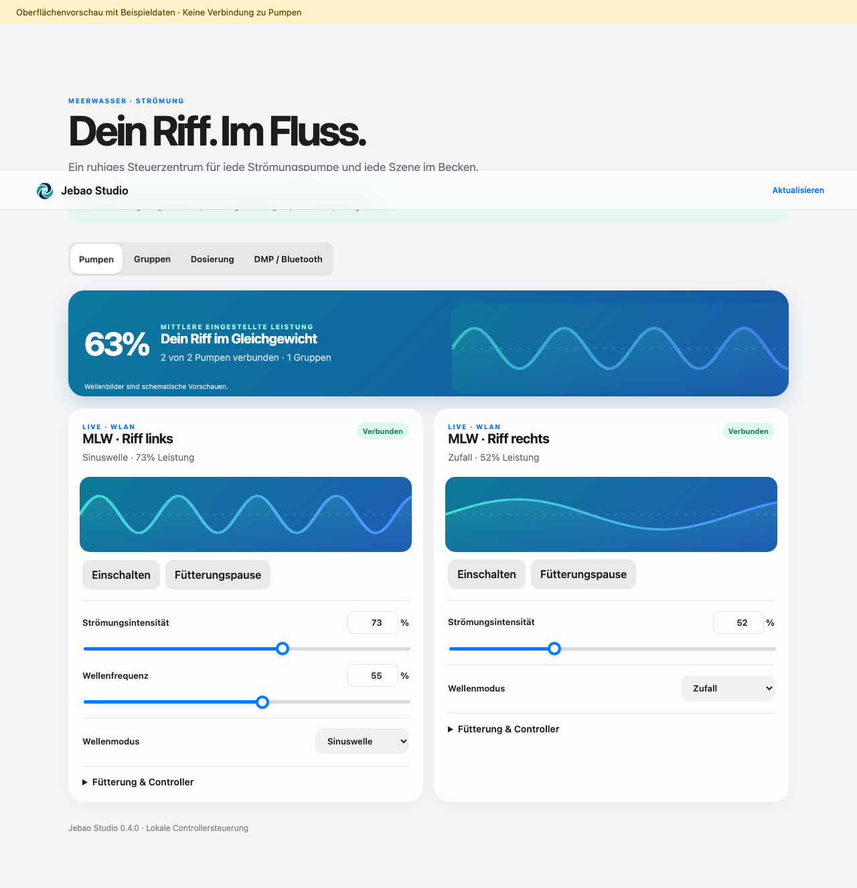

# Jebao Studio

Home-Assistant-Integration mit eigener Seitenleiste für Jebao/Jecod-Pumpen aus der **Jebao Aqua App**. Schwerpunkt: Strömungspumpen, insbesondere MLW über WLAN. Version **0.2.4, experimentell**.

<p align="center"></p>

**Aktueller Stand:** WLAN-Steuerung und Studio-Oberfläche sind implementiert und offline geprüft. Native Entitäten, Service-Aufrufe, Statusaktualisierungen und Entladen sind unter Home Assistant 2026.10.1 und 2026.10.4 mit simulierten Geräten geprüft. Der Hardwaretest steht aus. **DMP über reines Bluetooth lässt sich noch nicht steuern.** Dafür gibt es eine Einrichtung zur Schnittstellendiagnose. Dosierpumpen sind für die Erweiterung vorbereitet; ihre Steuerung ist gesperrt.



## Pumpen-Gruppen

Im Reiter **Gruppen** lassen sich erreichbare Strömungspumpen dauerhaft zu einer Gruppe zusammenfassen. Für jede Gruppe sind Ein/Aus, Fütterung, gemeinsame Leistung und Wellenmodus verfügbar, sofern die jeweiligen Controller diese Funktion unterstützen. Die Gruppen werden lokal in Home Assistant gespeichert; eine Gruppenaktion überspringt nicht erreichbare oder nicht kompatible Pumpen.

## Funktionen

- Eigene **Jebao Studio**-Seitenleiste für Administratoren, passend zum Konzept von Reef Studio und Vectra Studio.
- WLAN-Suche oder Einrichtung über die IP-Adresse; lokale Kommunikation ohne Konto.
- Leistung, Frequenz, Wellenmodus, Verbund, Fütterung und Gerätezeitplan-Schalter, soweit das erkannte Produktprofil sie anbietet.
- Native HA-Entitäten für Automationen, Statusmeldungen und Controllerfehler.
- Wiederverbindung und erneute Suche nach geänderter IP-Adresse.
- Optionaler, vom lokalen Betrieb getrennter Gizwits-Cloud-Modus.
- Bluetooth-Diagnoseeinträge für DMP: explizites Auslesen der GATT-Dienste und Eigenschaften als JSON. Keine Pumpenbefehle.
- Vorhandene Profile für ein-, vier- und fünfkanalige Dosiercontroller; derzeit ausschließlich Status/Diagnose.

Ein eigener Tagesplan-Editor, Gruppenprogramme, DMP-Bluetooth-Steuerung und Dosieraktionen sind **noch nicht implementiert**. Der Gerätezeitplan-Schalter aktiviert nur einen bereits auf dem Controller gespeicherten Plan.

## Kompatibilität

| Controller | Stand |
| --- | --- |
| MLW WLAN, ältere und neuere lokale Wavemaker-Profile | Treiber vorhanden; eigene Hardwareprüfung offen |
| Weitere WLAN-Strömungscontroller (M/MW, SLW, ALW/MCP/ELW-Familie) | Vorhandene Produktprofile; keine Garantie anhand der Modellbezeichnung |
| WLAN + BLE, sofern im WLAN eingerichtet | Steuerung über WLAN; kein BLE-Steuerungstreiber |
| DMP, reines Bluetooth | GATT-Diagnose vorbereitet; Steuerungsprotokoll fehlt |
| Weitere reine Bluetooth-Controller | Noch keine Steuerung |
| WLAN-Dosierpumpen | Profile und Statusbasis vorbereitet; keine Dosieraktionen |
| Controller ohne WLAN/Bluetooth | Keine direkte Verbindung vorgesehen |

Entscheidend ist der **Produkt-Key des Controllers**, nicht allein der Name der Pumpe. Es sind 18 konkrete WLAN-Produktdefinitionen enthalten. Unbekannte Geräte werden nicht durch ein geratenes Profil gesteuert. [Profile und Erweiterung](docs/compatibility.md).

## Installation

Voraussetzung: **Home Assistant 2026.10.1 oder neuer**. WLAN-Controller zuerst mit Jebao Aqua im WLAN einrichten. HA muss UDP **12414** und TCP **12416** des Controllers erreichen können.

1. Das Installationspaket [jebao-studio-0.2.4.zip](https://github.com/xsiimonox/jebao-studio/releases/download/v0.2.4/jebao-studio-0.2.4.zip) im Home-Assistant-Konfigurationsverzeichnis entpacken. Anschließend muss `/config/custom_components/jebao_studio/manifest.json` existieren. Alternativ den enthaltenen Ordner manuell kopieren.
2. Home Assistant neu starten.
3. **Einstellungen → Geräte & Dienste → Integration hinzufügen → Jebao Studio**.
4. Für MLW **WLAN-Controller im Netzwerk suchen** oder die IP-Einrichtung wählen.
5. **Jebao Studio** in der Seitenleiste öffnen. Controller im Router möglichst mit einer festen DHCP-Zuordnung versehen.
6. Für DMP die Integration erneut hinzufügen und **Bluetooth-Diagnose** wählen. Anschließend im Studio unter **Bluetooth / DMP** die Schnittstellen auslesen.

Keine andere Integration gleichzeitig auf dieselben Pumpen zugreifen lassen. Beim ersten Test die vom Gerät gemeldeten Werte mit der App vergleichen und zunächst eine einzelne Leistungsänderung prüfen.

## Installation über HACS

In HACS unter **Benutzerdefinierte Repositories** `https://github.com/xsiimonox/jebao-studio` als Kategorie **Integration** hinzufügen, **Jebao Studio** herunterladen und Home Assistant neu starten. Anschließend die Integration unter Geräte & Dienste hinzufügen. Eine Aufnahme in den HACS-Standardkatalog ist nicht beantragt.

[Ausführliche Installation, Updates und Entfernen](docs/installation.md) · [Fehlersuche und Profile](docs/compatibility.md) · [Änderungen](CHANGELOG.md)

## DMP-Bluetooth als nächster Schritt

Für deinen DMP-Controller benötigen wir die tatsächlichen GATT-Schnittstellen und einen Mitschnitt der App-Befehle. Die Diagnose allein bestätigt noch keine Steuerbarkeit. [Anleitung zur Bluetooth-Diagnose](docs/bluetooth.md).

Für WLAN-Steuerung wird kein Bluetooth-Proxy benötigt. Für DMP-Diagnose ist ein HA-Bluetooth-Adapter oder ein **aktiver**, erreichbarer ESPHome-Bluetooth-Proxy erforderlich. Ein Proxy ersetzt den noch fehlenden DMP-Protokolltreiber nicht.

## Entwicklung und Prüfungen

```sh
python3 -m unittest discover -s tests -v
npm test
python3 -m compileall -q custom_components
python3 tools/build_release.py
```

Die Prüfungen benötigen kein Home Assistant und keine Pumpen. Sie umfassen Produktprofile, Moduszuordnung, Paketverarbeitung und Steuertelegramme gegen erfasste App-Paketpräfixe. Zusätzlich wird die Integration gegen Home Assistant Core mit simulierten Geräten geprüft:

```sh
# Python 3.14, vorzugsweise in einer virtuellen Umgebung
python -m pip install -r requirements-test.txt
python -m pytest tests_homeassistant -q
```

Die native Suite prüft Entitätsregistrierung, Service-Aufrufe, Statusrückmeldungen, Wertevalidierung, Diagnose, Bluetooth-Zugriffsschutz, Dosiersteuerungssperre und Panelregistrierung. HTTP-Hosting und Geräteverbindungen werden dabei simuliert. Damit ist keine Gerätekompatibilität auf echter Hardware bewiesen.

Für die Oberflächenvorschau `python3 -m http.server 8765 --bind 127.0.0.1` starten und `http://127.0.0.1:8765/tools/preview.html` öffnen. Alle dort angezeigten Geräte sind Beispieldaten.

## Herkunft

Der WLAN-/Cloud-Unterbau und die Produktdefinitionen basieren auf dem MIT-lizenzierten [Jebao Aqua von chrisc123](https://github.com/chrisc123/jebao_aqua-homeassistant). Die separate Integration ist nicht erforderlich. Eigene Domain: `jebao_studio`. [Herkunft, Lizenzen und Änderungen](NOTICE.md).
